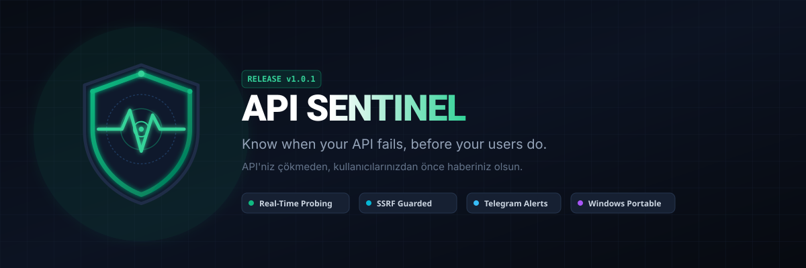
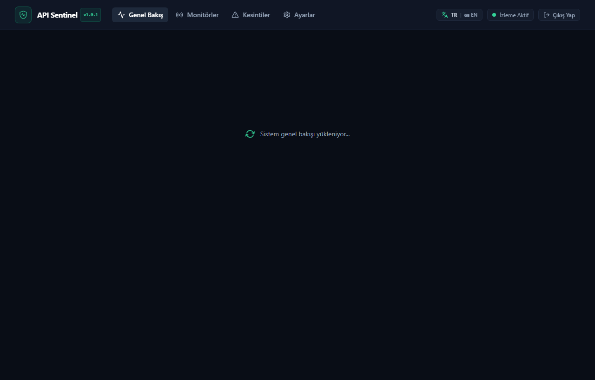
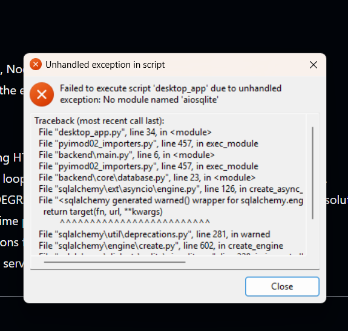

<div align="center">



# API Sentinel 🛡️

**Know when your API fails, before your users do.**

[English](README.md) • [Türkçe](README.tr.md)

[](https://github.com/akiffurkan/api-sentinel/releases/latest)
[-emerald.svg)](#-automated-testing--ci-verification)
[](#-strict-ssrf--network-security-policy)
[](LICENSE)
[](#-installation--deployment-options)

</div>

---

API Sentinel is an open-source, production-minded API monitoring platform and incident detection engine. It continuously probes your HTTP and HTTPS endpoints, tracks response latency, calculates estimated availability uptime, opens trackable incidents on failures, and immediately dispatches alerts via Telegram Bot API before your users are impacted.

---

## 📸 Real Dashboard Interface

Here is API Sentinel running in real-time, monitoring public APIs with live latency history and availability tracking:

<div align="center">



</div>

---

## 🛠️ Resolved Issues: `aiosqlite` Driver Fix (v1.0.1 / v1.0.2)

In the initial v1.0.0 Windows release, dynamic SQLAlchemy async driver loading caused an unhandled startup exception:

<div align="center">

| Previous v1.0.0 Bug | Resolution in v1.0.1+ |
|:---:|:---:|
|  | ✅ **Fully Fixed:** `aiosqlite`, `greenlet`, and SQLite async dialects are now statically linked into the portable executable bundle with zero external dependencies. |

</div>

---

## 📦 Installation & Deployment Options

API Sentinel supports three deployment methods, each tailored to different operational needs:

### Option A: 🪟 Standalone Windows Desktop App (Zero Setup)

Run API Sentinel as a native desktop application without installing Python, Node.js, or Docker:

👉 **[Download APISentinel.exe (v1.0.2)](https://github.com/akiffurkan/api-sentinel/releases/download/v1.0.2/APISentinel.exe)** *(~24 MB, Portable)*

- Double-click `APISentinel.exe` to launch.
- Automatic passwordless desktop admin session.
- SQLite database and logs are stored automatically in `%LOCALAPPDATA%\APISentinel`.

---

### Option B: 🐳 Docker & Docker Compose (Server & Cloud Deployment)

Deploy a multi-container stack with the FastAPI Web API, separate Background Worker, and static Nginx web client:

```bash
# 1. Clone the repository
git clone https://github.com/akiffurkan/api-sentinel.git
cd api-sentinel

# 2. Configure environment
cp .env.example .env
```

Edit `.env` to configure your administrator secret token and optional Telegram bot:

```env
APP_ENV=production
DATABASE_URL=sqlite+aiosqlite:////app/data/sentinel.db
ADMIN_TOKEN=your-strong-random-admin-secret-token

# Telegram Outage Alerts (Optional)
TELEGRAM_BOT_TOKEN=123456789:ABCdefGhIJKlmNoPQRstuVWXyz
TELEGRAM_CHAT_ID=-1001234567890

# Engine Defaults
DEFAULT_INTERVAL=60
DEFAULT_TIMEOUT=10
MAX_CONCURRENT_CHECKS=20
```

```bash
# 3. Start all services
docker compose up -d --build
```

- **Web Dashboard:** [http://localhost:3000](http://localhost:3000)
- **FastAPI OpenAPI Swagger UI:** [http://localhost:8000/docs](http://localhost:8000/docs)
- **Application Health Check:** [http://localhost:8000/healthz](http://localhost:8000/healthz)

---

### Option C: 🐧 Linux / Native Python Service (Bare-Metal / VPS)

Run API Sentinel directly on any Linux distribution (Ubuntu/Debian, Fedora, Rocky, Alpine):

```bash
# 1. Clone the repository
git clone https://github.com/akiffurkan/api-sentinel.git
cd api-sentinel

# 2. Setup Python 3.12+ virtual environment
python3 -m venv .venv
source .venv/bin/activate
pip install -r backend/requirements.txt

# 3. Build the React frontend
cd frontend
npm install
npm run build
cd ..

# 4. Start the Web API server
uvicorn backend.main:app --host 0.0.0.0 --port 8000

# 5. In a separate process or systemd service, run the background worker:
python -m backend.worker
```

---

## 🌟 Key Features

- **Asynchronous Health Probing:** Non-blocking HTTP GET checks powered by `httpx` with millisecond-precision latency measurement and customizable timeouts (1s - 60s).
- **Incident Lifecycle Management:**
  - `UP`: Healthy endpoint returning expected status codes.
  - `DEGRADED`: Single failure observed (prevents false alarms from transient network blips).
  - `DOWN`: Two consecutive failures open an official incident and trigger an immediate outage alert.
  - `RECOVERED`: When endpoint responds normally again, incident is resolved with total downtime duration calculated, and a recovery notification is dispatched.
  - **Spam Prevention:** Duplicate open incidents and repeated notifications are blocked while an outage is active.
- **Strict SSRF & Network Security Engine:**
  - Enforces `http` and `https` schemes only.
  - Blocks loopback (`127.0.0.0/8`, `::1`), RFC1918 private ranges (`10.0.0.0/8`, `172.16.0.0/12`, `192.168.0.0/16`), link-local (`169.254.0.0/16`), multicast, carrier-grade NAT, and cloud metadata services (`169.254.169.254`).
  - Resolves hostnames to all IP addresses and evaluates every resolved target (anti-DNS rebinding).
  - Re-evaluates every HTTP redirect hop against SSRF rules before following.
  - Restricts connections to documented safe ports (`80`, `443`, `8080`, `8443`).
  - Caps response reads at 1MB to prevent memory exhaustion; never persists response bodies.
- **Estimated Availability & Metrics:**
  - Calculates check-based availability uptime percentage from persisted check logs.
  - Computes average, p95, min, and max latency.
- **Telegram Bot Notifications:** Formatted outage and recovery alerts sent to your team chat or private bot channel. Never leaks API secrets in logs or API responses.
- **Dual Language Support (i18n):** Complete English and Turkish interface with live instant language toggle (TR / EN).

---

## 🧪 Automated Testing & CI Verification

API Sentinel enforces comprehensive automated test verification across unit, integration, and security layers:

```
============================= test session starts =============================
platform win32 -- Python 3.12.10, pytest-8.4.2, pluggy-1.7.0
rootdir: D:\Projeler\API Sentinel
configfile: pytest.ini
testpaths: tests
plugins: anyio-4.16.0, asyncio-0.26.0, mock-3.17.0
collected 25 items

tests/test_api_monitors.py::test_auth_enforcement PASSED                 [  4%]
tests/test_api_monitors.py::test_monitor_crud_and_ssrf PASSED            [  8%]
tests/test_api_monitors.py::test_manual_check_now_action PASSED          [ 12%]
tests/test_api_overview_and_incidents.py::test_healthz_endpoint PASSED   [ 16%]
tests/test_api_overview_and_incidents.py::test_overview_and_incidents PASSED [ 20%]
tests/test_checker.py::test_checker_success PASSED                       [ 24%]
tests/test_checker.py::test_checker_unexpected_status_code PASSED        [ 28%]
tests/test_checker.py::test_checker_timeout PASSED                       [ 32%]
tests/test_checker.py::test_checker_connect_error PASSED                 [ 36%]
tests/test_checker.py::test_checker_blocks_redirect_to_internal_ip PASSED [ 40%]
tests/test_incident_manager.py::test_incident_lifecycle PASSED           [ 44%]
tests/test_notifier.py::test_mask_secret PASSED                          [ 48%]
tests/test_notifier.py::test_notifier_send_outage_alert PASSED           [ 52%]
tests/test_notifier.py::test_notifier_send_recovery_alert PASSED         [ 56%]
tests/test_scheduler_and_analytics.py::test_analytics_uptime_and_latency_calculations PASSED [ 60%]
tests/test_scheduler_and_analytics.py::test_scheduler_deduplication_and_tick PASSED [ 64%]
tests/test_ssrf.py::test_ssrf_rejects_invalid_schemes PASSED             [ 68%]
tests/test_ssrf.py::test_ssrf_rejects_empty_or_malformed PASSED          [ 72%]
tests/test_ssrf.py::test_ssrf_rejects_userinfo PASSED                    [ 76%]
tests/test_ssrf.py::test_ssrf_rejects_loopback_and_local PASSED          [ 80%]
tests/test_ssrf.py::test_ssrf_rejects_private_networks PASSED            [ 84%]
tests/test_ssrf.py::test_ssrf_rejects_cloud_metadata_and_link_local PASSED [ 88%]
tests/test_ssrf.py::test_ssrf_rejects_disallowed_ports PASSED            [ 92%]
tests/test_ssrf.py::test_ssrf_allows_valid_public_domain PASSED          [ 96%]
tests/test_ssrf.py::test_ssrf_rejects_domain_resolving_to_private_ip PASSED [100%]

======================== 25 passed, 100% success rate ========================
```

Run tests locally:

```bash
pytest -v
```

---

## 📡 REST API Reference

| Method | Endpoint | Description |
|---|---|---|
| `GET` | `/healthz` | Unauthenticated application health status |
| `GET` | `/api/auth/verify` | Validates session `ADMIN_TOKEN` |
| `GET` | `/api/overview` | Dashboard summary, system uptime, and monitor stats |
| `GET` | `/api/monitors` | List all configured endpoint monitors |
| `POST` | `/api/monitors` | Create a new monitored target (SSRF validated) |
| `GET` | `/api/monitors/{id}` | Detailed monitor metrics, p95 latency, and incident timeline |
| `PATCH` | `/api/monitors/{id}` | Update monitor configuration or pause/resume checks |
| `DELETE` | `/api/monitors/{id}` | Delete monitor and its historical records |
| `GET` | `/api/monitors/{id}/checks` | Historical latency and probe result logs |
| `POST` | `/api/monitors/{id}/check-now` | Trigger an immediate manual probe |
| `GET` | `/api/incidents` | Incident history, outage durations, and recovery logs |
| `GET` | `/api/settings/info` | Safe configuration status (secrets masked) |
| `POST` | `/api/settings/test-telegram` | Dispatch test notification to verify bot setup |

---

## 📄 License

This project is open-source and licensed under the [MIT License](LICENSE).
