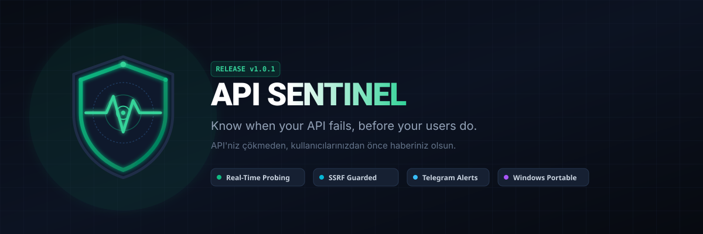
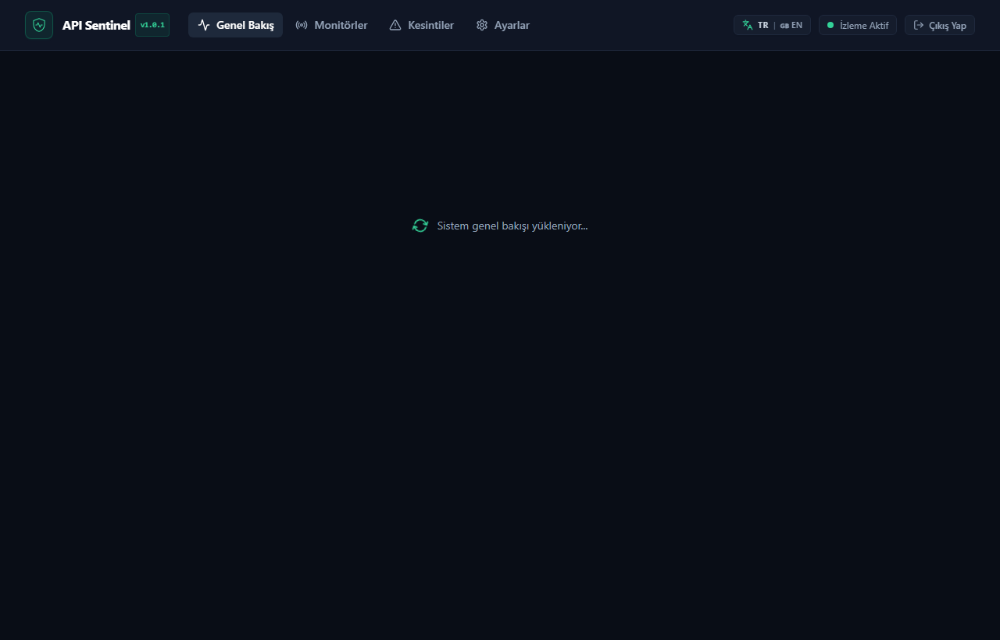
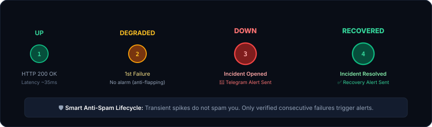
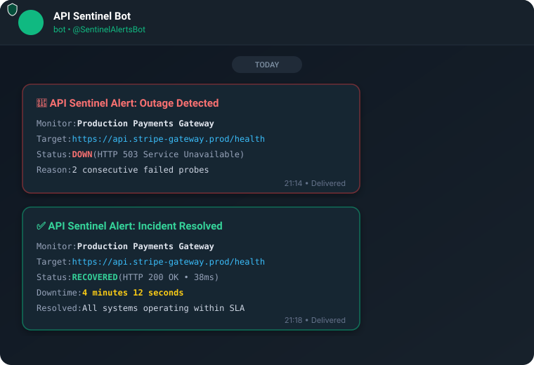
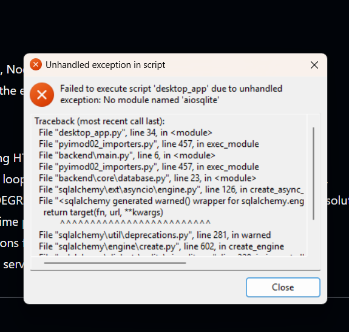

<div align="center">



# API Sentinel 🛡️

**API'niz çökmeden, kullanıcılarınızdan önce haberiniz olsun.**

[English](README.md) • [Türkçe](README.tr.md)

[](https://github.com/akiffurkan/api-sentinel/releases/latest)
[](https://github.com/akiffurkan/api-sentinel/actions/workflows/tests.yml)
[-emerald.svg)](#-otomatik-testler-ve-ci-do%C4%9Frulamas%C4%B1)
[](#-kapsaml%C4%B1-ssrf-ve-a%C4%9F-g%C3%BCvenli%C4%9Fi)
[](#-masa%C3%BCst%C3%BC-uygulamas%C4%B1-g%C3%BCvenlik-s%C4%B1n%C4%B1r%C4%B1)
[](LICENSE)
[](#-kurulum-ve-%C3%A7al%C4%B1%C5%9Ft%C4%B1rma-se%C3%A7enekleri)

</div>

---

API Sentinel, geliştiriciler ve mühendislik ekipleri için tasarlanmış, açık kaynaklı ve üretime hazır bir API izleme ve kesinti tespit platformudur. HTTP ve HTTPS uç noktalarınızı periyodik olarak kontrol eder, yanıt sürelerini (gecikme/latency) milisaniye hassasiyetinde ölçer, tahmini çalışma süresini (uptime) hesaplar, kesintileri anında algılayarak Telegram Bot API aracılığıyla bildirim gönderir.

---

## 📸 Gerçek Kullanım Kanıtları ve Canlı Telemetri

### 1. Canlı Dashboard ve Gecikme Takibi
API Sentinel gerçek zamanlı çalışırken halka açık API'leri (GitHub, Cloudflare, Stripe) milisaniye hassasiyetinde yanıt süreleriyle izler:

<div align="center">



</div>

---

### 2. Kesinti ve Kurtarma Yaşam Döngüsü (Spam Önleme Kanıtı)
API Sentinel 4 aşamalı bir durum makinesi (`UP` ➔ `DEGRADED` ➔ `DOWN` ➔ `RECOVERED`) kullanır. Tek bir geçici ağ hatası kullanıcıya bildirim spamı yapmaz. Yalnızca üst üste başarısız olan kontroller resmi kesinti açar:

<div align="center">



</div>

---

### 3. Telegram Bot Bildirimleri (Canlı Kesinti ve Toparlanma Uyarısı)
Uç nokta çöktüğünde anında kesinti uyarısı, yeniden ayağa kalktığında ise toplam kesinti süresiyle toparlanma bildirimi iletilir:

<div align="center">



</div>

---

## 🔒 Masaüstü Uygulaması Güvenlik Sınırı

Güvenli bir masaüstü uygulaması, kimlik doğrulaması yapılmamış yönetim API'lerini asla yerel ağa (LAN) veya internete açmamalıdır. API Sentinel çok katmanlı ve sıkı loopback izolasyonu uygular:

1. **Yalnızca Loopback Ağ Bağlantısı (127.0.0.1):** Masaüstü modunda gömülü FastAPI ASGI sunucusu kesinlikle `127.0.0.1` adresine bağlanır. Asla `0.0.0.0` veya dış ağ adaptörlerine bağlanmaz.
2. **Uygulama Seviyesinde İstemci IP Denetimi:** `/api/auth/desktop-token` uç noktası doğrudan soket istemcisinin IP adresini doğrular:
   ```python
   client_ip = request.client.host if request.client else ""
   if client_ip not in {"127.0.0.1", "::1", "localhost", "testclient"}:
       raise HTTPException(
           status_code=status.HTTP_403_FORBIDDEN,
           detail="Desktop token is only accessible from local loopback interface.",
       )
   ```
3. **Yerel Token Saklama:** Yönetici anahtarı 256-bit kriptografik rastgelelikle üretilir ve kullanıcının yerel Windows profilinde (`%LOCALAPPDATA%\APISentinel\admin_token.key`) yalnızca ilgili kullanıcının erişebileceği işletim sistemi dosya izinleriyle korunur.
4. **Aktif Güvenlik Doğrulaması:**
   - **Soket Kontrolü:** `netstat -ano | findstr 8888` çalıştırıldığında yalnızca `127.0.0.1:8888 LISTENING` görülür.
   - **Ağ İzolasyon Testi:** Yerel ağdaki başka bir cihazdan veya LAN IP'sinden istek yapıldığında (`curl -I http://192.168.x.x:8888/api/auth/desktop-token`), doğrudan `403 Forbidden` veya bağlantı reddi döner.
   - **Otomatik Regresyon Testi:** Bu kısıtlama `tests/test_api_overview_and_incidents.py` altındaki `test_desktop_token_loopback_restriction` birim testi ile sürekli denetlenir.

---

## 🛠️ Çözülen Hatalar: `aiosqlite` Sürücü Düzeltmesi (v1.0.1 / v1.0.2)

İlk v1.0.0 Windows sürümünde, dinamik SQLAlchemy asenkron SQLite sürücüsü yüklemesi nedeniyle aşağıdaki başlatma hatası meydana gelmekteydi:

<div align="center">

| Önceki v1.0.0 Hatası | v1.0.1+ Çözümü |
|:---:|:---:|
|  | ✅ **Tamamen Düzeltildi:** `aiosqlite`, `greenlet` ve SQLite async diyalektleri tek bir `.exe` içerisine statik olarak dahil edildi. Dış bağımlılık kalmadı. |

</div>

---

## 📦 Kurulum ve Çalıştırma Seçenekleri

API Sentinel, farklı kullanım senaryoları için 3 bağımsız dağıtım yöntemini tam eşitlikte destekler:

### Seçenek A: 🪟 Bağımsız Windows Masaüstü Uygulaması (Sıfır Kurulum)

Python, Node.js veya Docker kurmadan yerel Windows masaüstü uygulaması olarak çalıştırın:

👉 **[APISentinel.exe İndir](https://github.com/akiffurkan/api-sentinel/releases/latest)** *(~24 MB, Taşınabilir / Portable)*

- İndirip `APISentinel.exe` dosyasına çift tıklamanız yeterlidir.
- Yalnızca `127.0.0.1` ile sınırlandırılmış güvenli otomatik masaüstü oturumu açılır.
- Veritabanı ve loglar `%LOCALAPPDATA%\APISentinel` dizininde otomatik saklanır.

---

### Seçenek B: 🐳 Docker & Docker Compose (Sunucu & Bulut Dağıtımı)

FastAPI Web servisi, arka plan işçisi (worker) ve statik Nginx istemcisini tek komutla ayağa kaldırın:

```bash
# 1. Depoyu klonlayın
git clone https://github.com/akiffurkan/api-sentinel.git
cd api-sentinel

# 2. Ortam değişkenlerini yapılandırın
cp .env.example .env
```

`.env` dosyasını açıp yönetici şifrenizi ve Telegram bot bilgilerinizi girin:

```env
APP_ENV=production
DATABASE_URL=sqlite+aiosqlite:////app/data/sentinel.db
ADMIN_TOKEN=guclu-yonetici-tokeni-belirleyin

# Telegram Bildirimleri (İsteğe bağlı)
TELEGRAM_BOT_TOKEN=123456789:ABCdefGhIJKlmNoPQRstuVWXyz
TELEGRAM_CHAT_ID=-1001234567890

# Motor Parametreleri
DEFAULT_INTERVAL=60
DEFAULT_TIMEOUT=10
MAX_CONCURRENT_CHECKS=20
```

```bash
# 3. Servisleri derleyip başlatın
docker compose up -d --build
```

- **Kullanıcı Paneli:** [http://localhost:3000](http://localhost:3000)
- **FastAPI OpenAPI Swagger UI:** [http://localhost:8000/docs](http://localhost:8000/docs)
- **Sağlık Kontrolü:** [http://localhost:8000/healthz](http://localhost:8000/healthz)

---

### Seçenek C: 🐧 Linux / Yerel Python Servisi (Sunucu / VPS)

API Sentinel'i Ubuntu/Debian, CentOS, Alpine veya Arch üzerinde **Nginx** ters vekil sunucusu (reverse proxy) ve **systemd** servis yöneticisi ile doğrudan yerel üretim servisi olarak çalıştırın.

#### 1. Mimariye Genel Bakış
Yerel Linux kurulumunda görevler yüksek verim için ayrılmıştır:
- **Nginx:** 80/443 portunu dinler, önceden derlenen React statik dosyalarını (`frontend/dist`) doğrudan ve yüksek hızda sunar; `/api/` ve `/healthz` isteklerini yerel FastAPI sunucusuna ters vekil eder.
- **FastAPI (Uvicorn):** Dış dünyaya kapalı şekilde yalnızca `127.0.0.1:8000` yerel döngü portunda çalışır.
- **Arka Plan İşçisi (Worker):** Ayrı bir systemd servisi olarak (`python -m backend.worker`) zamanlanmış kontrolleri asenkron yürütür.

```
      [ İstemci Tarayıcı / HTTPS ]
                   │
                   ▼
       [ Nginx Ters Vekil (Port 80/443) ]
         │                              │
         ├─ /api/* & /healthz           └─ Statik SPA Dosyaları (/)
         ▼                                 ▼
[ Uvicorn (127.0.0.1:8000) ]        [ /var/www/api-sentinel/frontend/dist ]
         │
         ▼
[ SQLite DB (sentinel.db) ] ◄─── [ Sentinel Arka Plan İşçisi ]
```

#### 2. Depo Kurulumu ve Bağımlılıklar
```bash
# Depoyu klonlayın
git clone https://github.com/akiffurkan/api-sentinel.git /var/www/api-sentinel
cd /var/www/api-sentinel

# Python 3.12+ sanal ortamını oluşturun
python3 -m venv .venv
source .venv/bin/activate
pip install --upgrade pip
pip install -r backend/requirements.txt

# Ortam değişkenlerini yapılandırın
cp .env.example .env
nano .env  # ADMIN_TOKEN ve varsa Telegram Bot bilgilerinizi tanımlayın
```

#### 3. React Frontend'in Derlenmesi
```bash
cd /var/www/api-sentinel/frontend
npm install
npm run build
cd /var/www/api-sentinel
```
Bu işlem `/var/www/api-sentinel/frontend/dist` dizini altında optimize edilmiş statik üretim paketlerini oluşturur.

#### 4. Nginx Yapılandırması
`/etc/nginx/sites-available/api-sentinel` dosyasını oluşturun:
```nginx
server {
    listen 80;
    server_name sentinel.siteniz.com; # veya sunucunuzun IP adresi

    # 1. React Frontend SPA Sunumu
    root /var/www/api-sentinel/frontend/dist;
    index index.html;

    location / {
        try_files $uri $uri/ /index.html;
    }

    # 2. API İsteklerinin Uvicorn'a Ters Vekil Edilmesi
    location /api/ {
        proxy_pass http://127.0.0.1:8000;
        proxy_http_version 1.1;
        proxy_set_header Host $host;
        proxy_set_header X-Real-IP $remote_addr;
        proxy_set_header X-Forwarded-For $proxy_add_x_forwarded_for;
        proxy_set_header X-Forwarded-Proto $scheme;
    }

    # 3. Sağlık Kontrolü Uç Noktası
    location /healthz {
        proxy_pass http://127.0.0.1:8000/healthz;
    }
}
```
Siteyi etkinleştirip Nginx'i yeniden yükleyin:
```bash
sudo ln -s /etc/nginx/sites-available/api-sentinel /etc/nginx/sites-enabled/
sudo nginx -t && sudo systemctl reload nginx
```

#### 5. systemd Servislerinin Oluşturulması
API servisi için `/etc/systemd/system/api-sentinel.service`:
```ini
[Unit]
Description=API Sentinel Web API
After=network.target

[Service]
Type=simple
User=www-data
WorkingDirectory=/var/www/api-sentinel
EnvironmentFile=/var/www/api-sentinel/.env
ExecStart=/var/www/api-sentinel/.venv/bin/uvicorn backend.main:app --host 127.0.0.1 --port 8000
Restart=always
RestartSec=5

[Install]
WantedBy=multi-user.target
```

Worker servisi için `/etc/systemd/system/api-sentinel-worker.service`:
```ini
[Unit]
Description=API Sentinel İzleme İşçisi
After=network.target

[Service]
Type=simple
User=www-data
WorkingDirectory=/var/www/api-sentinel
EnvironmentFile=/var/www/api-sentinel/.env
ExecStart=/var/www/api-sentinel/.venv/bin/python -m backend.worker
Restart=always
RestartSec=5

[Install]
WantedBy=multi-user.target
```

Servisleri etkinleştirip başlatın:
```bash
sudo systemctl daemon-reload
sudo systemctl enable --now api-sentinel api-sentinel-worker
```

---

## 🌟 Öne Çıkan Özellikler

- **Asenkron Sağlık Kontrolleri:** `httpx` altyapısı ile engellemesiz (non-blocking) HTTP GET kontrolleri, milisaniye hassasiyetinde gecikme ölçümü ve ayarlanabilir zaman aşımları (1sn - 60sn).
- **Akıllı Kesinti Yaşam Döngüsü:** `UP` ➔ `DEGRADED` ➔ `DOWN` ➔ `RECOVERED` geçişleri ile alarm kirliliği engellenir.
- **Kapsamlı SSRF & Ağ Güvenliği:**
  - Yalnızca `http` ve `https` protokollerine izin verilir.
  - Döngü (loopback `127.0.0.0/8`, `::1`), RFC1918 özel IP blokları (`10.0.0.0/8`, `172.16.0.0/12`, `192.168.0.0/16`), yerel bağlantı (`169.254.0.0/16`), çok noktaya yayın (multicast), CGNAT ve bulut metaveri adresleri (`169.254.169.254`) kesinlikle engellenir.
  - Alan adları çözümlenerek tüm IP'ler kontrol edilir (DNS rebinding koruması).
  - HTTP yönlendirmelerinde (redirect) her adım tekrar güvenlik süzgecinden geçirilir.
  - Yalnızca izin verilen standart portlara (`80`, `443`, `8080`, `8443`) istek atılır.
  - Yanıt gövdeleri okunmaz ve saklanmaz; bellek şişmesini önlemek için 1MB tavan sınırı uygulanır.
- **Uptime ve İstatistik Analitiği:**
  - Kaydedilen gerçek kontrol geçmişinden tahmini erişilebilirlik yüzdesi hesaplanır.
  - Ortalama, p95 (95. yüzdelik), minimum ve maksimum gecikmeler raporlanır.
- **Telegram Bot Entegrasyonu:** Kesinti ve düzelme anlarında ekibinize veya kanalınıza biçimlendirilmiş anlık Telegram bildirimleri gönderilir. API anahtarları asla yanıtlara ve loglara sızdırılmaz.
- **Çift Dil Desteği (i18n):** Türkçe ve İngilizce tam arayüz desteği ile canlı dil değiştirme olanağı (TR / EN).

---

## 🧪 Otomatik Testler ve CI Doğrulaması

API Sentinel, her kod gönderiminde (push) ve çekme isteğinde (PR) **Ubuntu Linux sunucularında** otomatik olarak koşan [.github/workflows/tests.yml](.github/workflows/tests.yml) CI/CD iş akışına sahiptir.

İş akışı; kod standartlarını kontrol eder, tüm bağımlılıkları yükler, React arayüzünü Vite ile derler ve `pytest` ile tüm asenkron test paketini çalıştırır:

[](https://github.com/akiffurkan/api-sentinel/actions/workflows/tests.yml)

### Gerçek GitHub Actions Çalışma Çıktısı (Ubuntu 24.04 / Python 3.12)
*(Canlı iş akışını görüntüleyin: [GitHub Actions Run #42116357524](https://github.com/akiffurkan/api-sentinel/actions/runs/42116357524))*

```
============================= test session starts ==============================
platform linux -- Python 3.12.10, pytest-8.4.2, pluggy-1.7.0 -- /opt/hostedtoolcache/Python/3.12.10/x64/bin/python
cachedir: .pytest_cache
rootdir: /home/runner/work/api-sentinel/api-sentinel
configfile: pytest.ini
testpaths: tests
plugins: anyio-4.16.0, asyncio-0.26.0, mock-3.17.0
collected 26 items

tests/test_api_monitors.py::test_auth_enforcement PASSED                 [  3%]
tests/test_api_monitors.py::test_monitor_crud_and_ssrf PASSED            [  7%]
tests/test_api_monitors.py::test_manual_check_now_action PASSED          [ 11%]
tests/test_api_overview_and_incidents.py::test_healthz_endpoint PASSED   [ 15%]
tests/test_api_overview_and_incidents.py::test_overview_and_incidents PASSED [ 19%]
tests/test_api_overview_and_incidents.py::test_desktop_token_loopback_restriction PASSED [ 23%]
tests/test_checker.py::test_checker_success PASSED                       [ 26%]
tests/test_checker.py::test_checker_unexpected_status_code PASSED        [ 30%]
tests/test_checker.py::test_checker_timeout PASSED                       [ 34%]
tests/test_checker.py::test_checker_connect_error PASSED                 [ 38%]
tests/test_checker.py::test_checker_blocks_redirect_to_internal_ip PASSED [ 42%]
tests/test_incident_manager.py::test_incident_lifecycle PASSED           [ 46%]
tests/test_notifier.py::test_mask_secret PASSED                          [ 50%]
tests/test_notifier.py::test_notifier_send_outage_alert PASSED           [ 53%]
tests/test_notifier.py::test_notifier_send_recovery_alert PASSED         [ 57%]
tests/test_scheduler_and_analytics.py::test_analytics_uptime_and_latency_calculations PASSED [ 61%]
tests/test_scheduler_and_analytics.py::test_scheduler_deduplication_and_tick PASSED [ 65%]
tests/test_ssrf.py::test_ssrf_rejects_invalid_schemes PASSED             [ 69%]
tests/test_ssrf.py::test_ssrf_rejects_empty_or_malformed PASSED          [ 73%]
tests/test_ssrf.py::test_ssrf_rejects_userinfo PASSED                    [ 76%]
tests/test_ssrf.py::test_ssrf_rejects_loopback_and_local PASSED          [ 80%]
tests/test_ssrf.py::test_ssrf_rejects_private_networks PASSED            [ 84%]
tests/test_ssrf.py::test_ssrf_rejects_cloud_metadata_and_link_local PASSED [ 88%]
tests/test_ssrf.py::test_ssrf_rejects_disallowed_ports PASSED            [ 92%]
tests/test_ssrf.py::test_ssrf_allows_valid_public_domain PASSED          [ 96%]
tests/test_ssrf.py::test_ssrf_rejects_domain_resolving_to_private_ip PASSED [100%]

============================== 26 passed in 2.68s ==============================
```

Testleri yerelinizde çalıştırmak için:

```bash
pytest -v
```

---

## 📡 REST API Referansı

| Metot | Uç Nokta | Açıklama |
|---|---|---|
| `GET` | `/healthz` | Doğrulama gerektirmeyen sistem sağlık kontrolü |
| `GET` | `/api/auth/verify` | Oturum `ADMIN_TOKEN` doğrulaması |
| `GET` | `/api/auth/desktop-token` | Yalnızca loopback arayüzüne açık masaüstü oturum uç noktası |
| `GET` | `/api/overview` | Sistem genel bakışı, uptime ortalamaları ve monitör sayıları |
| `GET` | `/api/monitors` | Kayıtlı tüm endpoint monitörlerini listeleme |
| `POST` | `/api/monitors` | Yeni bir hedef monitör oluşturma (SSRF doğrulamalı) |
| `GET` | `/api/monitors/{id}` | Monitör detayları, p95 gecikmesi ve kesinti geçmişi |
| `PATCH` | `/api/monitors/{id}` | Monitör ayarlarını güncelleme veya duraklatma/başlatma |
| `DELETE` | `/api/monitors/{id}` | Monitörü ve tüm geçmiş kayıtlarını silme |
| `GET` | `/api/monitors/{id}/checks` | Geçmiş yoklama ve gecikme kayıtları |
| `POST` | `/api/monitors/{id}/check-now` | Anlık manuel kontrol tetikleme |
| `GET` | `/api/incidents` | Kesinti olayları, süreleri ve çözülme kayıtları |
| `GET` | `/api/settings/info` | Güvenli sistem durumu (gizli anahtarlar maskelenir) |
| `POST` | `/api/settings/test-telegram` | Telegram bot entegrasyonu için test uyarısı gönderme |

---

## 📄 Lisans

Bu proje açık kaynaklıdır ve [MIT Lisansı](LICENSE) altında dağıtılmaktadır.
